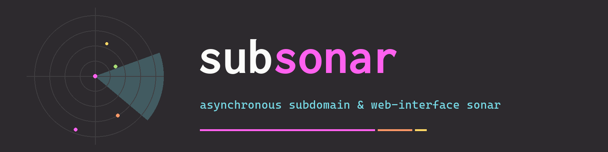

<p align="center">
  
</p>

# subsonar

**Asynchronous subdomain and web-interface scanner.**

subsonar takes a domain you are allowed to assess, collects possible hostnames, resolves them, and reports the ones that actually answer as a web page. It uses free public sources, an optional wordlist, a fixed pool of privacy-focused DNS resolvers, and a curated port list. A hostname is reported only when an HTTP or HTTPS probe looks like a real interface, and every finding gets a **0–100 confidence score** with the reasons attached.

Python 3.11 or newer. Windows, Linux, and macOS. [MIT](LICENSE) license.

## Features

Everything below is in the scanner today.

* **Three ways to run it:** a headless console (`subsonar scan`), a full-screen Textual TUI (`subsonar` or `subsonar tui`), and a local Streamlit dashboard (`subsonar web`).
* **Ten free OSINT sources, no API keys.** Built in: crt.sh, HackerTarget, Anubis. Plugins: CertSpotter, RapidDNS, urlscan.io, AlienVault OTX, ThreatMiner, Common Crawl, subdomain.center.
* **Eleven wordlists.** Ten public lists streamed from SecLists (and cached under `.subsonar_cache/` for 30 days) plus `ai-super`, a 23,052-label list that ships inside the package. `subsonar wordlists` prints them. The scan profile decides how many labels are used.
* **Eight scan profiles**, from a passive pass to a slow stealth sweep. `subsonar profiles` prints the live table.
* **Port matrices.** Core is 50 curated ports. Extended is 172. `web` is 10, `audit` is 30 admin ports. You can also pass lists and ranges (`--ports 8000-8100,11434`).
* **Custom DNS client.** Queries are raw UDP on asyncio sockets, sent only to the resolver pool below. The operating-system resolver is not used, including for the HTTP client.
* **Wildcard DNS filtering**, so a domain that answers for every name does not flood the report.
* **Provider-host policy.** Hosts whose CNAME chain ends on a shared mail, identity, or collaboration tenant (Exchange Online, SharePoint, Microsoft 365 identity, Okta, Auth0, and similar) are recorded and skipped. CDN and PaaS names (CloudFront, S3, Heroku, Netlify, Akamai, and similar) are still scanned, and the report notes the provider. `--scan-provider-hosts` scans the skipped families too.
* **Active discovery:** TLS certificate SAN names, CNAME chasing, and hostname permutations (`admin` → `admin-dev`, `dev-admin`, …).
* **Web mining.** `robots.txt`, sitemaps, `/.well-known/security.txt`, and selected response headers are mined for more in-scope names, then resolved in a second wave.
* **Apex DNS notes:** MX platform, SPF (including `include:` expansion), DKIM selectors, DMARC, CAA, NS/SOA, DNSSEC, and common third-party verification tokens.
* **Fingerprints:** favicon hash, 131 technology signatures, and status-only probes of sensitive paths such as `/.env` and `/.git/config`. Those probes do not read the file body.
* **Offline country and ASN** for each resolved address, from a local index built out of a public BGP dump. Lookups stay on the machine. `--no-geo` skips it.
* **Reverse DNS (PTR)** for resolved addresses.
* **Rate limits** on DNS queries and TCP connects, with per-profile defaults. `--dns-rate` and `--port-rate` override them (`0` removes the cap).
* **Carry-over.** A later scan of the same domain merges the previous report instead of starting from an empty table. `--no-carry-over` starts fresh.
* **Resume, diff, and TOML config.** Interrupted scans can continue, and `subsonar diff` compares a report with a saved baseline.
* **Optional zone transfer** (`--axfr`) and **IPv6** (`--ipv6`). Zone transfer talks directly to the target's nameservers.
* **Reports** in JSON, CSV, Markdown, HTML, and plain text. URLs-only and SARIF are opt-in.

An offline engine check, `subsonar selftest`, runs the pipeline against loopback servers and does not send traffic to the public internet.

## Requirements

* Python **3.11+** (`python3 --version`).
* Outbound network access for a real scan: DNS to the resolver pool, HTTPS to the OSINT sources, and HTTP to the target. Wordlists other than `ai-super` are downloaded on first use. The geo index is a separate one-time download of about 10 MB.
* On Debian and Ubuntu, the standard library venv module is a separate package. If `python3 -m venv` fails, install it (`sudo apt install python3-venv`, or `python3.12-venv` on some releases) and try again.

No paid APIs and no accounts.

## Install

After any of the installs below, `subsonar --help` should print the command list.

### pipx (recommended)

[pipx](https://pipx.pypa.io) installs the tool into its own environment and puts `subsonar` on your PATH.

```bash
pipx install "git+https://github.com/REFFIX-X/subsonar"
subsonar --help
```

pipx puts the command in `~/.local/bin`. If the shell says `subsonar: command not found`, run `pipx ensurepath` and open a new terminal.

To update later:

```bash
pipx install --force "git+https://github.com/REFFIX-X/subsonar"
```

### pip

Install into a virtual environment. Debian, Ubuntu, and other externally managed Pythons refuse `pip install` into the system interpreter.

```bash
python3 -m venv .venv
source .venv/bin/activate          # Windows PowerShell: .venv\Scripts\Activate.ps1
python -m pip install "git+https://github.com/REFFIX-X/subsonar"
subsonar --help
```

From a directory that already contains this repository, with the same virtual environment activated:

```bash
python -m pip install .
python -m pip install -e ".[dev]"  # editable checkout, plus pytest
```

### From a clone

```bash
git clone https://github.com/REFFIX-X/subsonar
cd subsonar
python3 -m venv .venv
source .venv/bin/activate          # Windows PowerShell: .venv\Scripts\Activate.ps1
python -m pip install -e ".[dev]"  # omit [dev] if you do not want pytest
subsonar --help
```

`python main.py ...` from the checkout runs the same program. `python -m subsonar ...` works once the package is installed.

A helper in the clone installs with pipx when pipx is on PATH. Otherwise it creates `.venv` in the checkout and installs there (so it still works when the system Python rejects pip). Running it again upgrades that same install.

```bash
./install.sh
```

Without pipx, the command is `.venv/bin/subsonar` until you activate `.venv`.

On Windows, this creates `.venv`, installs the checkout, and opens the dashboard:

```powershell
powershell -ExecutionPolicy Bypass -File .\install.ps1
```

| Flag | Effect |
|---|---|
| `-Port 8502` | dashboard port (default 8501) |
| `-NoBrowser` | do not open a browser |
| `-Reinstall` | delete `.venv` and install again |

`pip install -r requirements.txt` still installs the libraries a checkout needs, including pytest, and `python main.py` still runs. That path does not create the `subsonar` command. Prefer `pip install -e .`.

### Docker

The image includes the CLI, the TUI, and the web dashboard, so the build is large (Streamlit and pandas). Reports and the cache are written under `/data`.

```bash
docker build -t subsonar .
docker run --rm subsonar --help
docker run --rm subsonar --version
docker run --rm subsonar selftest
mkdir -p output
docker run --rm -v "$PWD/output:/data/output" subsonar scan example.com -p 1 --no-geo-download
```

The image starts as root only to make `/data` writable, then runs the scanner as the user `subsonar` (uid 1000). Reports in the mounted `output` directory are owned by that user. Mount the whole data directory if you also want the cache kept:

```bash
mkdir -p subsonar-data
docker run --rm -v "$PWD/subsonar-data:/data" subsonar scan example.com -p 1 --no-geo-download
```

Dashboard, then open <http://localhost:8501>:

```bash
docker run --rm -p 8501:8501 subsonar web --headless --port 8501
```

## Quick start

```bash
subsonar --help
subsonar profiles
subsonar wordlists

# Offline engine check. Loopback only, about a minute, no public-internet traffic.
subsonar selftest

# Small passive scan of the documentation domain. No wordlist brute force.
# It still queries OSINT sources and checks discovered names on ports 80 and 443.
subsonar scan example.com -p 1 --no-geo --no-geo-download
```

`example.com` is reserved for documentation. Scan domains you are allowed to test. A finished scan with no confirmed web interface exits **2**. That is a completed run, not a crash.

A real scan needs outbound UDP port 53 to the resolver pool. If none of those resolvers answer, the scan stops with exit code 1 and a short error. It does not keep retrying every name.

A few more useful invocations:

```bash
# Built-in wordlist (no download) and the short web port list.
subsonar scan example.com -p 2 --wordlist ai-super --port-matrix web

# Write a commented subsonar.toml, then scan with those settings.
subsonar init
subsonar scan example.com

# Full-screen UI on a terminal. With no TTY, this prints the command list.
subsonar

# Local dashboard at http://127.0.0.1:8501
subsonar web
subsonar web example.com --headless --port 8501
```

## Scan profiles

A profile sets three things: how many wordlist labels to take, which ports to sweep, and the default DNS and connect rates. `--wordlist`, `--port-matrix` / `--ports`, `--dns-rate`, and `--port-rate` each override one of those.

| # | Name | Wordlist slice | Ports | Default pace |
|---|---|---|---|---|
| 1 | Passive Only | none | web (10), verify only | 60 DNS q/s, no port sweep |
| 2 | Light Brute | first 1,000 | core 50 | 150 q/s · 400 connects/s |
| 3 | Medium Brute (default) | first 5,000 | core 50 | 250 q/s · 600 connects/s |
| 4 | Deep Brute | first 20,000 | core 50 | 300 q/s · 800 connects/s |
| 5 | Full Postal | first 5,000 | core 50 | 250 q/s · 500 connects/s |
| 6 | HTTP Quick Check | first 500 | web (10) | 300 q/s · 800 connects/s |
| 7 | Infrastructure Audit | first 2,000 | audit (30) | 250 q/s · 500 connects/s |
| 8 | Stealth Mode | first 5,000 | core 50 | 25 q/s · 60 connects/s, with pauses |

Profile 1 does not brute-force. It still collects OSINT and checks what it found over HTTP. Profiles 2–8 add a wordlist. Profile 5 is OSINT plus the medium brute. Profile 8 inserts randomised delays of about 0.35–1.25 seconds.

```bash
subsonar scan example.com -p passive
subsonar scan example.com -p 8 --dns-rate 20 --port-rate 30
```

## Configuration and options

`subsonar scan --help` lists every flag. These are the ones that change a run the most:

| Flag | What it does |
|---|---|
| `-p, --profile` | Profile number `1`–`8` or its key (`passive`, `light`, `medium`, …). Default is 3. |
| `--wordlist NAME` | Which list to draw labels from. Default `seclists-top1m`. `ai-super` needs no download. |
| `--port-matrix NAME` | `core`, `extended`, `web`, or `audit`. |
| `--ports SPEC` | Replace the matrix: `80,443,8443` or `8000-8100` or a mix. |
| `--dns-rate QPS` | DNS queries per second for the whole pool. `0` means no cap. |
| `--port-rate CPS` | TCP connects per second. `0` means no cap. |
| `--offline` | Do not download wordlists. Uses the cache, the built-in `ai-super` list, or a small embedded seed. OSINT, DNS, and HTTP still run. |
| `--no-geo` | Skip country / ASN enrichment and the geo download. |
| `--no-geo-download` | Use a geo index you already have. Do not download one. |
| `--no-dns-intel` | Skip MX, SPF, DKIM, DMARC, CAA, NS/SOA, DNSSEC. |
| `--no-reverse-dns` | Skip PTR lookups. |
| `--no-mining` | Skip robots.txt, sitemap, security.txt, and header mining. |
| `--no-carry-over` | Do not merge the previous report for this domain. |
| `--no-discovery` | Skip SAN harvesting, permutations, and CNAME chasing. |
| `--scan-provider-hosts` | Also probe shared mail / identity / collaboration tenants. |
| `--resume` | Continue a saved scan of this domain. |
| `--domains a.com,b.com` | More targets, scanned one after another. |
| `--formats LIST` | `json,csv,md,html,txt` by default. Also `urls`, `sarif`, `jsonl`. |
| `--jsonl` | Stream each finding to a live `.jsonl` file as it is confirmed. |
| `--output DIR` | Report directory. |
| `--no-reports` | Print progress and do not write report files. |
| `--axfr` | Try a DNS zone transfer. This connects to the target's own nameservers. |
| `--ipv6` | Also resolve AAAA and probe IPv6 addresses. |
| `--config FILE` | TOML file to load. Default is `./subsonar.toml` when that file exists. |

`subsonar init` writes a commented `subsonar.toml` in the current directory. If that file is present, `subsonar scan example.com` uses it, and flags you pass on the command line win. Keys the program does not recognise are ignored. The domain itself is still the command argument.

Environment variables:

| Variable | Effect |
|---|---|
| `SUBSONAR_OUTPUT` | Default report directory when `--output` is not set. |
| `SUBSONAR_CACHE` | Default cache directory (wordlists, DNS cache, geo index, resume state). |
| `SUBSONAR_GEOIP_OFFLINE` | Set to `1` to refuse the geo download. An index that is already on disk is still used. |

**Where files go.** An installed `subsonar` (pip, pipx, or Docker) writes `./output` and `./.subsonar_cache` in the directory where you run it, unless you override them. A source checkout, including `pip install -e .` of a clone, keeps those directories in the repository root, which is the layout `python main.py` has always used.

Other commands: `subsonar geoip --build`, `--stats`, `--lookup 23.227.38.74`; `subsonar diff example.com`; `subsonar resume --all`; `subsonar selftest`.

## Output and the 0–100 score

A scan writes a timestamped set of files. The default set is:

* `subsonar_<domain>_<timestamp>.json` — full result, including score reasons
* `.csv` — one row per finding
* `.md` — Markdown report with links
* `.html` — a single dark HTML file
* `.txt` — plain text

`urls` writes a list of links. `sarif` writes a SARIF document. Ask for either with `--formats`.

Exit codes: **0** a report was written and it contains findings, **2** the scan finished and no web interface was confirmed, **1** an error, **130** interrupted (Ctrl+C).

A finding is a hostname whose HTTP response looks like an application:

| Response | Kind | Meaning |
|---|---|---|
| 2xx or a same-port 3xx with a body or a title | `interface` | a page is there |
| 401, 403, 407, 429, 451 | `restricted` | something is answering and refusing the request |
| a redirect to a different port, and nothing else on that host answered | `redirect` | the link points at the destination |
| plain HTTP sent to a TLS-only port, empty 404s, bare 5xx | dropped | not reported as an interface |

Several ports that serve the same page are collapsed into one row. The extra ports are listed as aliases.

**The score** is an integer from 0 to 100 stored as `confidence`, with a label and two lists, `reasons` and `penalties`.

| Label | Score |
|---|---|
| `high` | 75–100 |
| `medium` | 45–74 |
| `low` | 0–44 |

Points are added for a real 2xx, a page title, a plausible body size, TLS, a `Server` header, a favicon hash, technology matches, security headers, data-file responses, a fingerprint that is not shared with siblings, and more than one resolver agreeing on the address. Points are taken away for client and server errors, redirect-only ports, a missing or empty title, a tiny or empty body, a fingerprint or body size shared with other findings, a wildcard address, alias ports, and a single-resolver answer. A gated status such as 401 or 403 gets credit for "an application is present" and a penalty because the content was not served, so it ranks below an open page and above an empty error. The JSON report includes the exact reason strings for that row.

## Privacy and DNS resolvers

DNS queries do leave your machine. They go to this pool, and only this pool. The client speaks DNS itself over UDP, so the resolver configured on your operating system (and therefore your ISP's resolver, if that is what the OS uses) is not asked. The HTTP client uses the same pool, so web probes do not fall back to the system resolver either.

| Address | Also | Operator |
|---|---|---|
| `9.9.9.10` | `149.112.112.10` | Quad9, uncensored |
| `194.242.2.2` | `194.242.2.4` | Mullvad DNS |
| `185.228.168.168` | `185.228.169.168` | CleanBrowsing |
| `76.76.2.0` | `76.76.19.19` | Control D |
| `94.140.14.14` | `94.140.15.15` | AdGuard DNS |
| `194.150.168.168` | `5.175.46.10` | OpenNIC |
| `84.200.69.80` | `84.200.70.40` | DNS.WATCH |
| `91.239.100.100` | `89.233.43.71` | UncensoredDNS |
| `159.89.120.20` | `185.95.218.42` | Blindside Networks, Applied Privacy |

The pool is checked when the package is imported. It refuses Google Public DNS (`8.8.8.8`, `8.8.4.4`), Cloudflare DNS (`1.1.1.1`, `1.0.0.1`), and Quad9's filtered address (`9.9.9.9`). Before a scan, each node is probed and silent ones are skipped for that run.

What else is sent, and what is not:

* **OSINT sources** receive the apex domain you asked to scan. They are third-party websites.
* **HTTP probes** connect to the target hostnames.
* **`--axfr`** connects to the target's authoritative nameservers. It is off unless you ask.
* **Country and ASN** come from a local database. Building it downloads public BGP and RIR files once (about 10 MB). The scanned addresses are not submitted to a geo API. Skip the download with `--no-geo`, `--no-geo-download`, or `SUBSONAR_GEOIP_OFFLINE=1`.
* **Flag pictures** in the web dashboard and the HTML report are loaded from `flagcdn.com` using the two-letter country code only.

Those resolver operators can see the names you look up. "Privacy-focused" here means the pool is a fixed, documented set that leaves out Google, Cloudflare, and the system resolver. It does not mean the queries are invisible.

## Ethical use

subsonar is for authorised security testing, for inventory of domains you operate, and for labs and CTFs. Scanning, brute-forcing, or probing systems you do not have permission to test is unlawful in many places and can disrupt someone else's service. You are responsible for every target you pass to this tool. If you are not sure you are allowed to scan it, do not scan it.

## Developing

```bash
python -m pip install -e ".[dev]"
python -m pytest tests -q
subsonar selftest
```

`selftest` is the network-free check of the whole engine. The pytest suite covers the engine, the reporters, and the TUI without a real terminal.

## License

[MIT](LICENSE) © 2026 REFFIX-X
